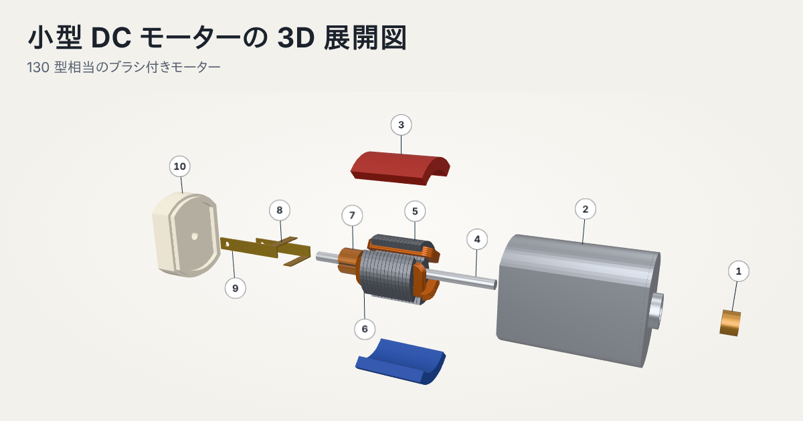

# ⚙️ 小型 DC モーターの 3D 展開図

模型や電子工作で使われる小型 DC モーターを，3D の展開図で表示する Web サイトである．
部品へマウスを重ねるかタップすると，名前と役割の解説を表示する．
GitHub Pages で公開している．

## 📑 目次

- [🌐 公開サイト](#-公開サイト)
- [🖼 画面](#-画面)
- [🧩 表示する部品](#-表示する部品)
- [🖱 操作方法](#-操作方法)
- [🛠 開発](#-開発)
- [🌍 対応ブラウザーと動作の軽さ](#-対応ブラウザーと動作の軽さ)
- [📁 ディレクトリ構成](#-ディレクトリ構成)
- [🚀 公開の仕組み](#-公開の仕組み)
- [♿ アクセシビリティ](#-アクセシビリティ)
- [📏 モデルについての注意](#-モデルについての注意)
- [📄 ライセンス](#-ライセンス)

## 🌐 公開サイト

<https://tomio2480.github.io/dc-motor-exploded-view/>

## 🖼 画面



図 1. 展開した状態の表示

## 🧩 表示する部品

130 型相当の 3 極ブラシ付き DC モーターを，表 1 の 10 種類の部品に分けて表示する．
番号は図中のラベルと対応する．

表 1. 表示する部品と役割

| 番号 | 部品 | 役割 |
|---|---|---|
| 1 | 軸受 | シャフトを支えて滑らかに回す |
| 2 | モーターケース | 部品を収め，磁力の通り道になる |
| 3 | 永久磁石 | 回転に必要な磁界をつくる |
| 4 | シャフト | 回転を外へ取り出す軸 |
| 5 | 電機子鉄心 | 巻線がつくる磁力を強める |
| 6 | 巻線 | 電流を流して電磁石にする |
| 7 | 整流子 | 電流の向きを切り替える |
| 8 | ブラシ | 回る整流子へ電気を伝える |
| 9 | 端子 | 電源をつなぐ接続口 |
| 10 | エンドベル | 後ろ側のふたと土台 |

## 🖱 操作方法

表 2. 操作と動作

| 操作 | 動作 |
|---|---|
| 部品へマウスを重ねる | ポインターの近くへ解説を表示する |
| 部品または番号をクリック・タップ | 解説を固定して表示する．もう一度選ぶと閉じる |
| 狭い画面で部品を選ぶ | 選んだ部品へ寄って大きく表示する．解説を閉じると全体へ戻る |
| ドラッグ | 視点を回転する |
| ホイール・ピンチ | 拡大と縮小を行う |
| 矢印キー | 視点を回転する |
| `+` キー・`-` キー | 拡大と縮小を行う |
| `Esc` キー | 解説を閉じる |
| 「展開の度合い」スライダー | 組立から展開までの間を連続的に切り替える |
| 「組み立てる」「展開する」ボタン | 組立と展開をアニメーションで切り替える |
| 「視点を戻す」ボタン | 視点を初期の向きへ戻す |
| 「部品一覧」 | 部品の一覧を開き，選んだ部品の解説を表示する |

## 🛠 開発

### 前提条件

- Node.js 22 系（22.12 以上）または 24 系
- npm
- cccc v1.9.2（複雑度の検査を実行する場合）

### セットアップ

```bash
cd /path/to/your/repo
npm ci
npm run dev
```

### コマンド

表 3. 開発で使うコマンド

| コマンド | 内容 |
|---|---|
| `npm run dev` | 開発サーバーを起動する |
| `npm run build` | 型検査のあと，`dist/` へビルドする |
| `npm run preview` | ビルド結果をローカルで配信する |
| `npm test` | 単体テストを実行する |
| `npm run test:e2e` | E2E テストとアクセシビリティの自動検査を実行する |
| `npm run check` | 型検査・lint・整形の確認・単体テストをまとめて実行する |
| `npm run complexity` | cccc で関数ごとの複雑度を検査する |
| `npm run format` | 整形を適用する |
| `npm run generate:assets` | favicon の PNG と OGP 画像を再生成する |

### E2E テスト

E2E テストは Chromium・Firefox・WebKit の 3 つのエンジンで実行する．
初回の実行前に，`npx playwright install` でブラウザーを取得する．
特定のエンジンだけを実行する場合は，プロジェクト名で絞る．

```bash
npm run test:e2e -- --project="chromium-*"
```

既定以外の Chromium を使う場合は，環境変数 `PLAYWRIGHT_CHROMIUM_PATH` へ実行ファイルのパスを指定する．

GPU のない Linux では，画面なしの Firefox が WebGL を作れない．
その場合は，仮想画面の上で Firefox を画面ありで起動する．

```bash
E2E_FIREFOX_HEADED=1 xvfb-run --auto-servernum npm run test:e2e -- --project="firefox-*"
```

### 複雑度の検査

保守しやすさを保つため，関数ごとの複雑度へ上限を設けている．
計測には [cccc](https://github.com/moznion/cccc) を使い，CI でも同じ検査を実行する．

表 4. 複雑度の上限

| 指標 | 上限 | 判定 |
|---|---|---|
| 認知的複雑度 | 15 | 値を超える関数があれば失敗 |
| 循環的複雑度 | 10 | 値を超える関数があれば失敗 |

cccc は npm では配布されていない．
[GitHub Releases](https://github.com/moznion/cccc/releases/tag/v1.9.2) から v1.9.2 のバイナリを取得し，`PATH` の通った場所へ置く．
別の場所へ置いた場合は，環境変数 `CCCC_BIN` へパスを指定する．

```bash
CCCC_BIN=/path/to/cccc npm run complexity
```

Debian と Ubuntu には，同名の別の道具（C and C++ Code Counter）がある．
`apt install cccc` で入る道具は別物のため，使わない．
検査スクリプトは版を確認し，異なる道具や版では失敗する．

閾値と数え方の出典は `scripts/check-complexity.mjs` の冒頭に記している．
cccc は入れ子の関数を別の単位として数えるため，外側の関数の値は低く出る．
版を上げるときは，スクリプトと `.github/workflows/ci.yml` の版と SHA-256 をそろえて更新する．

## 📁 ディレクトリ構成

表 5. 主なディレクトリと内容

| パス | 内容 |
|---|---|
| `src/motor/` | 寸法，断面の計算，部品の解説，3D 形状の生成 |
| `src/view/` | 展開の計算，画角合わせ，Three.js による描画 |
| `src/ui/` | 選択状態，解説の表示，ポインターとキーボードの入力 |
| `tests/` | 単体テスト（Vitest） |
| `e2e/` | E2E テスト（Playwright と axe-core） |
| `scripts/` | アイコンと OGP 画像の生成，複雑度の検査 |
| `docs/notes/` | 設計判断の記録 |

3D 形状は外部のモデルファイルを使わず，`src/motor/dimensions.ts` の寸法から生成する．

## 🌍 対応ブラウザーと動作の軽さ

### 対応ブラウザー

WebGL 2 に対応した Chrome・Firefox・Safari・Edge の現行版を対象とする．
WebGL を使えない環境では，3D の代わりに全部品の解説を文章で表示する．
CI では Chromium・Firefox・WebKit（Safari と同じ描画エンジン）で E2E テストを実行する．
画面の設定は，デスクトップに加えて Pixel 7 と iPhone 15 を使う．
WebKit での検証は実機の Safari の代わりにはならないため，iOS の実機での確認も別に行う．

### 動作の軽さ

スマートフォンでの閲覧を想定し，表 6 の方針で負荷を抑えている．
数値は 2026-11-19 に Pixel 7 相当の画面設定で計測した．

表 6. 負荷を抑える方針と計測値

| 項目 | 方針 | 計測値 |
|---|---|---|
| 転送量 | 外部のモデルや画像を読み込まず，形状をコードから生成する | JavaScript 約 155 kB，CSS 約 2.5 kB（いずれも gzip） |
| 描画命令 | 同じ材質の形状を 1 つのメッシュへまとめる | 1 フレームあたり 24 回 |
| ポリゴン数 | 曲面の分割数を必要な範囲に抑える | 約 3.9 万 |
| 静止時の描画 | 表示が変わったときだけ描画する | 静止中は 0 回 |
| 解像度 | デバイスピクセル比の上限を 2 とする | - |
| 形状の生成 | 起動時に 1 度だけ行う | 約 11 ms（開発機の CPU） |

GPU での描画時間は，実機でなければ計測できない．
上の数値は，描画命令とポリゴンの量，および CPU 側の処理時間を示すものである．

## 🚀 公開の仕組み

`main` ブランチへの push で `.github/workflows/deploy.yml` が動き，GitHub Pages へ公開する．
初回のみ，リポジトリの Settings → Pages で Source を「GitHub Actions」へ設定する．

## ♿ アクセシビリティ

準拠の目標と確認状況は [ACCESSIBILITY.md](ACCESSIBILITY.md) に記録している．

## 📏 モデルについての注意

寸法は 130 型と呼ばれるモーターの一般的な大きさを目安にした概略値である．
特定の製品の図面を再現したものではない．
永久磁石の色は極を区別するための表現であり，実物の色とは異なる．

## 📄 ライセンス

[MIT License](LICENSE)
